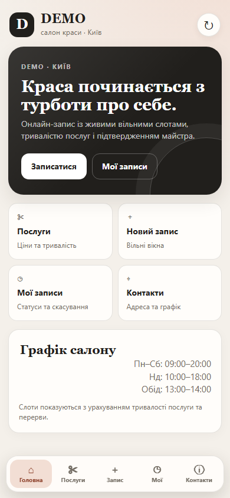
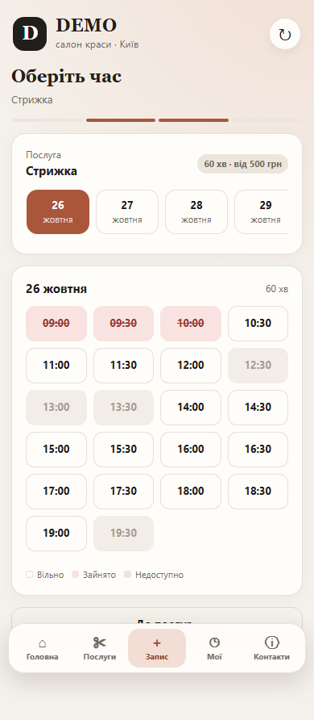
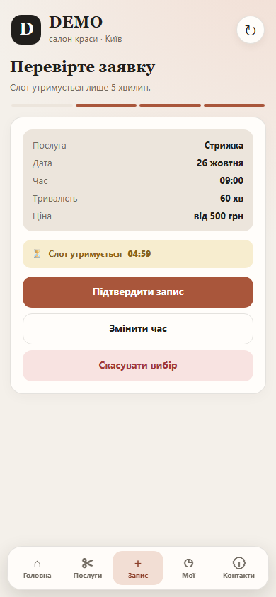
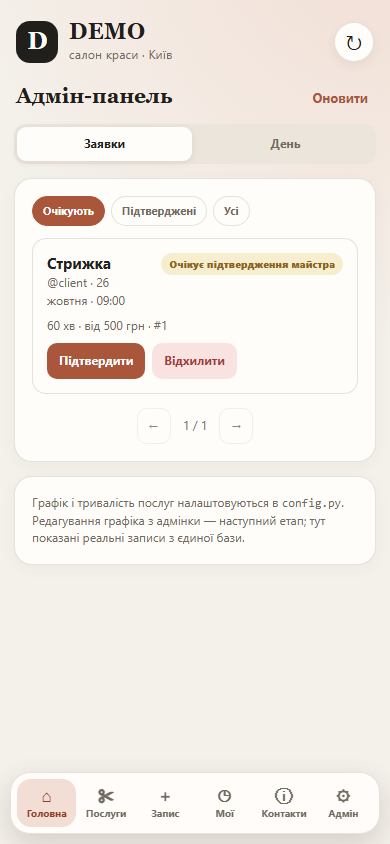

# DEMO — Telegram Mini App і бот салону краси

Telegram-бот і Mini App для демонстраційного салону краси в Києві.
Обидва інтерфейси працюють з **однією SQLite-базою** та одними серверними
правилами: послуги, тривалість, графік, 5-хвилинне утримання, заявки,
підтвердження майстра й скасування.

Оплати, реальний графік майстра та багатомайстерність не реалізовані —
це явно позначені наступні етапи.

## Архітектура

```text
bot-2/
├── bot.py                  # polling, health/web-сервер, cleanup-потік
├── config.py               # env, DEMO, послуги, графік, WEBAPP_URL
├── database.py             # SQLite: єдиний реєстр утримань і заявок
├── schedule.py             # дати, слоти, перерви, тривалість, скасування
├── notifications.py        # async-сповіщення з бота (PTB)
├── telegram_api.py         # sync Bot API для операцій із Mini App
├── mini_app_auth.py        # перевірка Telegram initData (HMAC-SHA256)
├── mini_app_api.py         # Flask JSON API Mini App
├── web.py                  # Flask: /health, /, /app, статичні файли
├── webapp/
│   ├── index.html          # Mini App shell
│   ├── styles.css          # адаптивна тема Telegram
│   └── app.js              # клієнт: запис, статуси, адмін-вкладка
├── docs/                   # скриншоти локального перевірочного прогону
├── texts.py                # українські тексти
├── keyboards.py            # inline-клавіатури; кнопка Mini App
├── handlers/
│   ├── common.py           # /start, /menu, /help, error handler
│   ├── user.py             # бот: запис, мої записи, скасування
│   └── admin.py            # бот: заявки, фільтри, дії майстра
├── tests/
│   ├── test_booking.py
│   ├── test_handlers.py
│   ├── test_mini_app_auth.py
│   ├── test_mini_app_api.py
│   └── test_schedule.py
├── requirements.txt
├── render.yaml
├── runtime.txt
├── .env.example
└── README.md
```

### Один реєстр

- Бот і Mini App викликають ті самі функції `database.py`.
- Немає окремої таблиці зайнятості для Mini App.
- `availability` у Mini App читає `bookings` через `get_occupied_intervals()`.
- Створення утримання, підтвердження, відхилення, скасування й перевірка
  перетинів виконуються в SQLite-транзакціях.
- Запис, створений у боті, видно в Mini App, і навпаки.
- Адмінські дії в боті та Mini App змінюють ті самі рядки.

### Міграція

`init_db()` створює таблицю/індекси та для старої бази додає `price_label`,
`duration_minutes` і `client_token`. Старі `t1…t5` читаються як 10:00…18:00,
тому наявні записи не ламають перевірку перетинів. Дані не скидаються.
Міграція повторно запускається під час старту й покрита тестом.

### Потік клієнта

`послуга → дата → час → held (5 хв) → pending → confirmed / rejected`

- Слоти враховують робочі години, перерву 13:00–14:00 і тривалість послуги.
- Зайнятий інтервал не показується як вільний.
- Після підтвердження заявка має статус `pending`; остаточною вона стає лише
  після рішення майстра.
- Клієнт може скасувати `pending`/`confirmed` не пізніше ніж за 2 години.

## Скриншоти

Локальний headless-прогін із підписаним тестовим initData (не живий Telegram):






## Локальний запуск

Потрібен Python 3.11+.

```bash
python -m venv .venv
```

Windows:

```powershell
.venv\Scripts\Activate.ps1
```

Linux/macOS:

```bash
source .venv/bin/activate
```

```bash
pip install -r requirements.txt
```

Змінні середовища:

```powershell
$env:BOT_TOKEN = "токен_від_BotFather"
$env:ADMIN_CHAT_ID = "ваш_telegram_id"
$env:DB_PATH = "bot.db"
$env:WEBAPP_URL = "https://ваш-публічний-https-хост/app"
python bot.py
```

- `WEBAPP_URL` необов'язковий. Якщо його не задати, на Render буде
  використано `https://<RENDER_EXTERNAL_HOSTNAME>/app`.
- Telegram відкриває Mini App лише за **HTTPS**. Для локальної перевірки
  потрібен HTTPS-тунель (наприклад, Cloudflare Tunnel або ngrok), інакше
  відкрийте UI у браузері — він покаже, що потрібен Telegram initData.
- `ADMIN_CHAT_ID` необов'язковий: без нього адмін-панель і сповіщення
  майстру недоступні.
- `PORT` необов'язковий; локально health-сервер використовує 10000.
- `DB_PATH` необов'язковий; за замовчуванням `bot.db`.

`.env.example` — лише шаблон; бот не завантажує `.env` автоматично.

## Як відкрити Mini App у Telegram

1. Задеплойте сервіс або підніміть HTTPS-тунель.
2. Переконайтеся, що `GET https://<host>/health` повертає `ok`.
3. Відкрийте `https://<host>/app` у Telegram WebView або задайте
   `WEBAPP_URL=https://<host>/app` у змінних Render.
4. У боті надішліть `/start` — у головному меню з'явиться
   **«📱 Відкрити Mini App»** з `web_app`-кнопкою.
5. За бажанням у BotFather: `/setmenubutton` → URL Mini App, щоб відкривати
   його з меню бота.

Mini App не працює без підписаного `Telegram.WebApp.initData`. Це зроблено
навмисно: звичайний браузер не повинен мати доступ до записів.

## API та безпека

Усі `/api/*`, крім перевірки здоров'я, вимагають заголовок
`X-Telegram-Init-Data` (або `Authorization: tma <initData>`).

Сервер:

- перевіряє HMAC-SHA256 `initData` токеном бота;
- перевіряє `auth_date` (не старіше 1 доби, не більше 5 хв у майбутньому);
- бере `user_id` лише з підписаного initData;
- перевіряє адміністратора через `ADMIN_CHAT_ID`;
- не довіряє ціні, тривалості, статусу чи `user_id`, надісланим клієнтом;
- валідує `service_id`, дату, канонічний час, розмір JSON і ключів;
- повертає безпечні JSON-помилки без traceback;
- не віддає `BOT_TOKEN` у JavaScript.

Основні endpoints:

- `GET /api/config` — салон, послуги, графік, `is_admin`;
- `GET /api/availability?service_id=...` — доступні дати;
- `GET /api/availability?service_id=...&date=...` — слоти зі станами
  `free / booked / past / unavailable`;
- `POST /api/holds` — створити утримання (підтримує `Idempotency-Key`);
- `POST /api/holds/<id>/submit` — надіслати заявку (ідемпотентно);
- `DELETE /api/holds/<id>` — скасувати утримання;
- `GET /api/bookings` — власні записи;
- `GET /api/bookings/<id>` — власна заявка (або будь-яка для адміна);
- `DELETE /api/bookings/<id>` — скасувати за правилом;
- `GET /api/admin/bookings?status=...&page=...` — адмін-список;
- `GET /api/admin/day?date=YYYY-MM-DD` — активні записи дня;
- `POST /api/admin/bookings/<id>/confirm|reject` — рішення майстра.

Додатково:

- CSP, `X-Content-Type-Options`, `Referrer-Policy` на `/` і `/app`;
- `Cache-Control: no-store` для API;
- ліміт тіла запиту 64 КБ;
- SQLite WAL, `BEGIN IMMEDIATE`, частковий унікальний індекс і перевірка
  перетинів інтервалів.

## Уведомлення

- Заявка з Mini App сповіщає майстра через Bot API.
- Підтвердження/відхилення з Mini App сповіщає клієнта.
- Скасування клієнтом сповіщає майстра.
- Бот використовує async-канал PTB, Mini App — server-side Bot API.
- Помилка доставки логується й **не** відкочує зміну в БД.
- Повторних спроб доставки поки немає.

## Тести

```bash
python -m unittest discover -s tests -v
```

Базове середовище без Flask/PTB:

- виконуються тести БД, графіка, авторизації, обробників бота;
- API-тести пропускаються з позначкою `Flask is not installed`.

Повний набір у venv після `pip install -r requirements.txt`:

- 60 тестів;
- перевіряються initData, підробка user_id, доступ адміна, API-помилки,
  ідемпотентність, спільна зайнятість бота/Mini App, скасування, пагінація,
  статичний UI, міграція схеми та всі старі сценарії бота.

Фактично перевірено локально: Python 3.14, PTB 22.8, Flask 3.1.3, tzdata.
Окремого прогону на Python 3.11 і живого Telegram-клієнта не було.

## Render і збереження даних

`render.yaml` запускає той самий процес: polling-бот, Flask health/API/UI та
cleanup-потік. Build: `pip install -r requirements.txt`, Start: `python bot.py`,
Health: `/health`.

На **free** Render файлова система тимчасова: SQLite-файл може зникнути після
redeploy. Для production потрібен paid instance із persistent disk:

- mountPath: `/var/data`
- `DB_PATH=/var/data/bot.db`
- `WEBAPP_URL=https://<host>/app`
- один екземпляр сервісу (SQLite не призначений для кількох одночасних
  екземплярів).

Без цього дані не гарантовані після перезапуску/redeploy. Це не приховано:
у `render.yaml` є відповідний комментар.

## Що замінити перед реальним запуском

У `config.py`:

- `SALON_NAME` (зараз `DEMO`), `ADDRESS`, `PHONE`, `PHONE_URI`, `INSTAGRAM_URL`;
- `SERVICES` — назви, ціни, тривалість, опис;
- `WORKING_HOURS`, `WORKING_HOURS_BY_WEEKDAY`, `BREAKS`, `SLOT_STEP_MINUTES`;
- `BOOKING_DAYS_AHEAD`, `CANCELLATION_CUTOFF_MINUTES`;
- `TIMEZONE`.

Графік і послуги поки задаються в коді. Адмін-вкладка Mini App керує заявками,
але **не** редагує графік, перерви, вихідні, ціни чи тривалість — це наступний
етап. Заглушок замість цих функцій немає.

## Обмеження

- Один майстер (`ADMIN_CHAT_ID`), без `master_id` і окремих календарів.
- Немає редагування розкладу/послуг з адмінки.
- Немає закритих інтервалів, свят і відпусток.
- Немає телефону клієнта, нагадувань і оплат.
- Активне утримання після рестарту бота можна підтвердити з Mini App
  («Мої записи» → «Підтвердити»), але не зі старого повідомлення бота.
- Сповіщення не мають retry/outbox.
- SQLite на free Render не переживає redeploy без persistent disk.
- Живий Telegram Mini App, BotFather і Render-деплой не запускалися в цій
  сесії; перевірені код, API-тести, статичні файли, реальна реєстрація
  handlers з PTB 22.8 і Flask test client.

## Подальші пріоритети

1. Мультимайстерність: `master_id`, окремі графіки, фільтр слотів.
2. Адмін-редактор графіка, перерв, вихідних, закритих інтервалів і послуг.
3. Телефон/контакт клієнта та нагадування.
4. Retry/outbox для сповіщень.
5. Persistent DB і backup.
6. E2E-перевірка Mini App у реальному Telegram.
